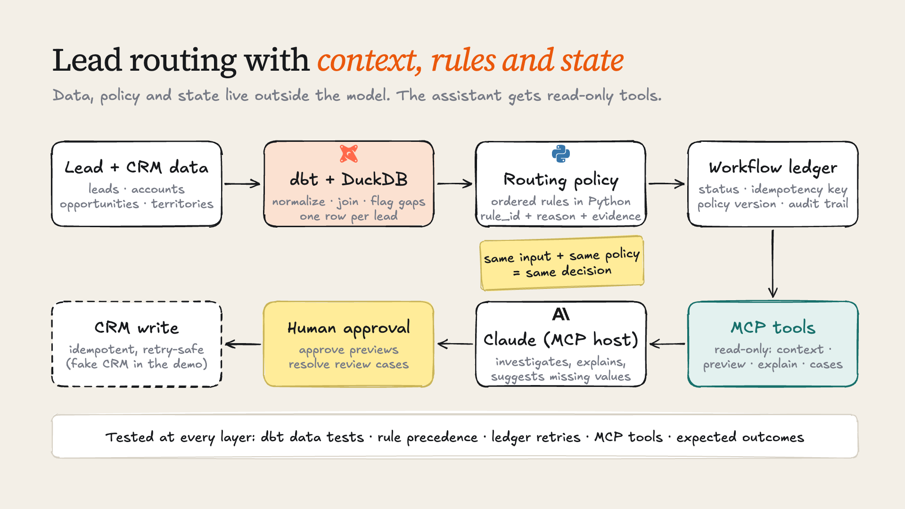
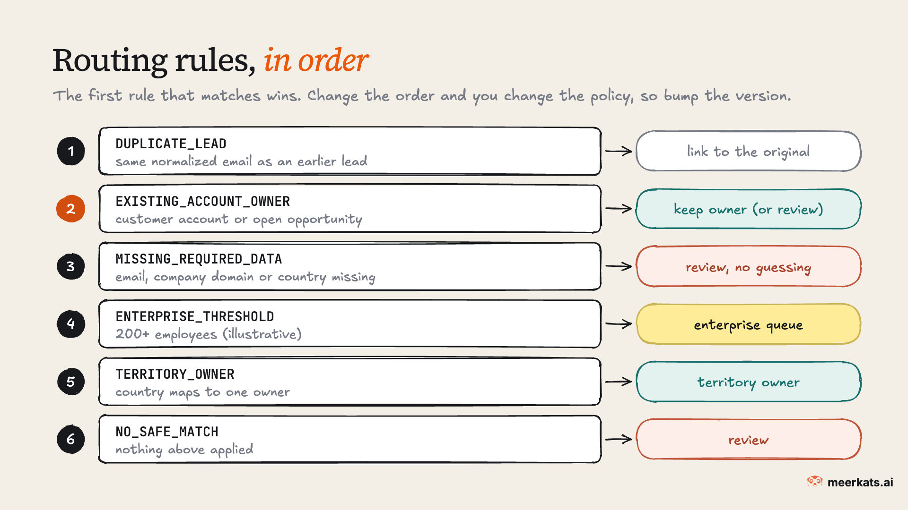

# Lead routing with context, rules and state

[](https://github.com/meerkatsai/lead-routing-context-demo/actions/workflows/tests.yml)


A small, runnable example of AI-assisted lead routing. dbt prepares the business context, plain Python applies the routing policy, a ledger tracks workflow state so retries are safe, and an MCP server gives Claude (or any MCP host) read-only tools to inspect leads and explain decisions.

The model never picks the owner. It reads context, explains the rule that fired, and can suggest a missing value, and every suggestion goes to a human.



> **Status: educational prototype.** It runs locally on synthetic data. There is no real CRM connection, no authentication and no multi-worker concurrency. See [What this does not do](#what-this-does-not-do).

## The problem

A new lead arrives. The company looks enterprise-sized, but it might already be a customer. There could be an open opportunity with an owner. The country field is blank, and the same person signed up last week with a slightly different email format.

You can ask an LLM "who should own this lead?" and get a plausible answer. What you won't get is the same answer every time, a rule you can point to, protection against assigning the same lead twice, or a record of why. Those come from the system around the model.

This repo splits the job up:

| Layer | Tool here | Job |
|---|---|---|
| Business context | dbt + DuckDB | Normalize emails, domains, countries and sizes. Join accounts, open opportunities and territories. Flag missing fields and duplicates. One row per lead. |
| Decision | Python (`policy.py`) | Ordered, versioned rules. Returns `rule_id`, `reason` and `evidence` for every decision. No I/O, no model calls. |
| Workflow state | SQLite ledger (`workflow.py`) | One case per lead, input fingerprint and policy version. Approvals, retries and an audit trail. |
| Assistance | MCP server (`mcp_server.py`) | Six read-only tools: list, inspect context, preview, preview with a model-suggested country, inspect a case, explain the policy. |
| Side effects | Fake CRM (`crm_stub.py`) | Idempotent owner writes, with simulated outages and lost responses so you can watch retries work. |

## Quick start

You need Python 3.11+ and git. No API keys or accounts are required.

```bash
git clone https://github.com/meerkatsai/lead-routing-context-demo.git
cd lead-routing-context-demo
python3 -m venv .venv
source .venv/bin/activate          # Windows: .venv\Scripts\activate
pip install -e ".[dev]"
```

Build the context model. This loads the synthetic CSVs, builds `lead_routing_base` and runs 16 dbt data tests:

```bash
lead-routing build
```

```
Done. PASS=26 WARN=0 ERROR=0 SKIP=0 NO-OP=0 REUSED=0 TOTAL=26
```

Check every lead against the expected outcomes in `data/expected_outcomes.csv`:

```bash
lead-routing eval
```

```
lead_id  expected                                  got                                       match
-------  ----------------------------------------  ----------------------------------------  -----
L-001    TERRITORY_OWNER -> own_maya               TERRITORY_OWNER -> own_maya               yes
L-002    EXISTING_ACCOUNT_OWNER -> own_oliver      EXISTING_ACCOUNT_OWNER -> own_oliver      yes
L-003    EXISTING_ACCOUNT_OWNER -> own_maya        EXISTING_ACCOUNT_OWNER -> own_maya        yes
L-004    EXISTING_OWNER_MISSING -> revops_review   EXISTING_OWNER_MISSING -> revops_review   yes
L-005    OWNER_CONFLICT -> revops_review           OWNER_CONFLICT -> revops_review           yes
...
L-015    EXISTING_ACCOUNT_OWNER -> own_priya       EXISTING_ACCOUNT_OWNER -> own_priya       yes

accuracy 15/15   false assignments 0   review rate 33%
```

Run the test suite (it builds its own copy of the warehouse in a temp folder):

```bash
pytest
```

```
50 passed
```

## Walk through the workflow

Route every lead and record a case for each:

```bash
lead-routing route-all
```

```
lead_id  rule_id                 destination       case_status      case_id            ledger
-------  ----------------------  ----------------  ---------------  -----------------  --------
L-001    TERRITORY_OWNER         own_maya          previewed        case_46357e2fb198  new case
L-002    EXISTING_ACCOUNT_OWNER  own_oliver        previewed        case_0b6eb8e9692e  new case
L-004    EXISTING_OWNER_MISSING  revops_review     review_required  case_417e5b342370  new case
L-005    OWNER_CONFLICT          revops_review     review_required  case_4eb2824a5b42  new case
L-012    DUPLICATE_LEAD          L-001             duplicate        case_bb1ddc8fc342  new case
...
```

Run it again, or rebuild dbt and run it again. Every row now says `existing case`, because the input fingerprint and policy version haven't changed. Your case IDs will differ from the ones shown here.

Look at one decision:

```bash
lead-routing preview L-003
```

```json
{
  "lead_id": "L-003",
  "status": "assigned",
  "queue_or_owner": "own_maya",
  "rule_id": "EXISTING_ACCOUNT_OWNER",
  "reason": "Kept the owner of the existing account/opportunity",
  "needs_review": false,
  "policy_version": "v1",
  "evidence": {
    "account_id": "A-102",
    "is_existing_customer": false,
    "account_owner_id": "own_maya",
    "open_opportunity_ids": ["O-500"],
    "open_opportunity_owner_ids": ["own_maya"]
  },
  "data_quality_flags": []
}
```

L-003 has no country, so a territory rule can't run. The open opportunity already has an owner, and that rule comes first, so the owner is kept.

Approve a case and write it, simulating a CRM timeout where the write lands but the response is lost:

```bash
lead-routing apply case_46357e2fb198              # refused: case is previewed, not approved
lead-routing approve case_46357e2fb198 --by maya.chen
lead-routing apply case_46357e2fb198 --simulate-timeout
lead-routing apply case_46357e2fb198              # retry
lead-routing crm-writes
```

```
apply failed and was recorded on the case: TimeoutError('CRM write may have succeeded, but the response was lost'). Run apply again to retry.
case_46357e2fb198: applied -> own_maya (crm action crm_7d1153cab4)

lead_id  owner_or_queue  action_id
-------  --------------  --------------
L-001    own_maya        crm_7d1153cab4
```

There's one write. The retry reused the case's idempotency key, so the CRM returned the first write instead of making a second one.

Settle a review case. A human picks the destination and has to leave a note:

```bash
lead-routing resolve case_4eb2824a5b42 --owner own_maya --by rev.ops \
  --note "Negotiation-stage opportunity owner keeps the account"
lead-routing apply case_4eb2824a5b42
lead-routing case case_4eb2824a5b42                # full audit trail
```

## Routing rules



The first rule that matches wins. The order is part of the policy. For example, rule 2 sitting above rule 4 is why an existing customer with 900 employees keeps its account owner instead of going to the enterprise queue. Every pair of rules that can match the same lead has a test in `tests/test_policy.py`.

The rules and the 200-employee threshold are **illustrative**. Replace them with your company's ownership rules, change `LEAD_ROUTING_POLICY_VERSION` when you do, and the ledger will supersede open cases with a reason (`policy v1 -> v2`).

## Connect Claude

The MCP server exposes six tools, all annotated `readOnlyHint: true`:

| Tool | What it returns |
|---|---|
| `list_leads_for_routing(limit)` | Up to 100 leads with a one-line summary each |
| `get_lead_context(lead_id)` | Normalized lead, account, open opportunities, territory, source timestamps, and the lead's notes labelled `notes_untrusted` |
| `preview_route(lead_id)` | The policy decision plus whether the ledger already has a case for it |
| `preview_route_with_country_hint(lead_id, country_code, evidence)` | A decision using a country the assistant inferred from the notes. Validated against the allowed list, quoted evidence required, always `needs_review: true` |
| `get_routing_case(case_or_lead_id)` | Case status, attempts, errors and audit events |
| `explain_routing_policy()` | The ordered rules, version and threshold |

**Claude Desktop:** add this to `claude_desktop_config.json` (Settings → Developer → Edit Config), using the absolute path to your clone, then restart Claude Desktop:

```json
{
  "mcpServers": {
    "lead-routing-demo": {
      "command": "/ABSOLUTE/PATH/TO/lead-routing-context-demo/.venv/bin/lead-routing-mcp"
    }
  }
}
```

On Windows the command is `...\\.venv\\Scripts\\lead-routing-mcp.exe`. A copy is in [`examples/claude_desktop_config.json`](examples/claude_desktop_config.json).

**Claude Code:**

```bash
claude mcp add lead-routing-demo -- "$(pwd)/.venv/bin/lead-routing-mcp"
```

Then try:

- "Why did L-005 go to review? Show me the evidence."
- "L-006 has no country. Read its notes and preview a route with your best guess."
- "List every lead that needs a human and explain why, one line each."

For the second one, Claude should call `preview_route_with_country_hint` with `IN` and quote "based in Pune". The tool runs the normal policy on it and returns `own_priya` marked for review. Claude never writes anything.

## How the pieces fit

```
dbt_project/
  seeds/                 synthetic leads, accounts, opportunities, territories, country aliases
  models/staging/        per-source cleanup
  models/lead_routing_base.sql   the routing contract: one row per lead
  models/schema.yml      data tests (unique keys, accepted values, relationships)
  tests/                 singular test: no lead dropped or duplicated by joins
src/lead_routing/
  policy.py              ordered rules, pure function
  context.py             read-only DuckDB access, input fingerprint
  workflow.py            ledger: cases, transitions, audit events, idempotent apply
  crm_stub.py            fake CRM with idempotency keys and failure simulation
  assist.py              validation for model-suggested values
  mcp_server.py          read-only MCP tools
  cli.py                 lead-routing command
data/expected_outcomes.csv   the eval set: expected rule and destination per lead
tests/                   policy, data model, ledger and MCP tests
```

More detail on each design choice, including why the duplicate check runs first and why unknown company size gets flagged instead of treated as zero, is in [docs/architecture.md](docs/architecture.md).

## Configuration

Everything has a default, and every setting can be overridden with an environment variable:

| Variable | Default |
|---|---|
| `LEAD_ROUTING_DUCKDB` | `warehouse/lead_routing.duckdb` |
| `LEAD_ROUTING_LEDGER` | `warehouse/ledger.sqlite` |
| `LEAD_ROUTING_FAKE_CRM` | `warehouse/fake_crm.sqlite` |
| `LEAD_ROUTING_POLICY_VERSION` | `v1` |
| `LEAD_ROUTING_ENTERPRISE_THRESHOLD` | `200` |

To start over, delete the `warehouse/` folder and run `lead-routing build`.

## Tested versions

Tested on macOS with Python 3.12.12, dbt-core 1.12.6, dbt-duckdb 1.11.1, duckdb 2.0.0, mcp 2.3.0 and pytest 9.1.1. CI runs the build, eval and tests on Python 3.11, 3.12 and 3.13 on Ubuntu.

The MCP code targets the **2.x Python SDK**, where `FastMCP` was renamed `MCPServer` (`from mcp.server import MCPServer`). Older tutorials that import `mcp.server.fastmcp` fail on 2.x.

## What this does not do

- **No real CRM.** `crm_stub.py` stands in for one. Many CRM APIs don't accept idempotency keys. If yours doesn't, read the current owner before writing, and reconcile timeouts before retrying.
- **Single machine only.** SQLite with `BEGIN IMMEDIATE` serializes transitions on one machine. Several workers need a server database with row locks, or a durable workflow engine.
- **No auth, tenancy or secrets handling.** The MCP server runs locally over stdio, for one user.
- **Synthetic policy.** The rules, the order and the threshold are examples.
- **Exact-match dedupe.** Duplicates are matched on normalized email only, with no fuzzy matching on names or companies.
- **No observability stack.** Decisions and transitions are logged to the ledger. A production setup would also emit traces (OpenTelemetry, for example) and alert on failed or stuck cases.

A sensible path to production: run read-only on synthetic data (this repo), then shadow mode on live leads where you compare against human decisions, then human approval before every write, then automatic writes for one low-risk route, and expand from there.

## Troubleshooting

- **`warehouse/lead_routing.duckdb not found`**: run `lead-routing build` first.
- **`Could not set lock on file`**: another process has the DuckDB file open for writing, usually a `dbt build` that's still running. The app opens the file read-only and closes it straight away, so retry once dbt finishes.
- **`No module named 'mcp.server.fastmcp'`**: you're running v1 example code against the v2 SDK. Use `MCPServer` as in `mcp_server.py`.
- **Claude Desktop doesn't show the tools**: check that the path in the config is absolute, that it points at `lead-routing-mcp` inside `.venv`, and that you fully restarted Claude Desktop.

## Contributing

Issues and pull requests are welcome, especially new edge cases. To add one, add a row to the seed CSVs and to `data/expected_outcomes.csv`, write a test for the precedence it touches, and make sure `pytest` passes. Please don't commit real personal or customer data.

## License

MIT. See [LICENSE](LICENSE). Built by [Meerkats](https://meerkats.ai).
