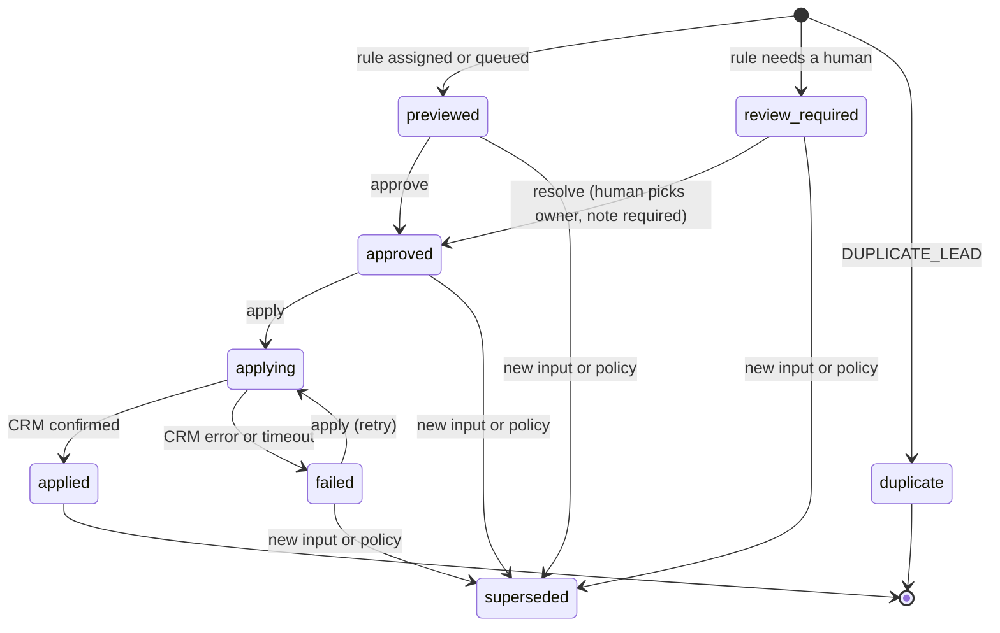

# Architecture and design notes

This page explains why the repo is shaped the way it is. The [README](../README.md) covers setup and usage.

## The principle

Code makes the policy decisions that have to be consistent. The model helps where reading language or explaining evidence adds something. Persistent state makes it safe to run anything twice.

## 1. Context: the dbt model is the contract

`lead_routing_base` is the only thing the policy reads. It has one row per lead, and everything a rule needs is already a column:

| Column | Where it comes from |
|---|---|
| `email_normalized` | `lower(trim(email))` |
| `company_domain_normalized` | The provided domain with the scheme, `www.` and path stripped. If that's blank, the email domain, unless it's a personal mailbox (`free_email_domains` seed). |
| `company_domain_source` | `provided` or `email`, so a reviewer can see when the domain was derived |
| `country_code` | Raw country lower-cased, then looked up in `country_aliases` (`usa`, `United Kingdom`, `Germany` → `US`, `GB`, `DE`) |
| `employee_count` | `try_cast` after removing thousands separators. `"1,200"` → 1200, `"unknown"` → null |
| `duplicate_of_lead_id` | The earliest lead with the same normalized email |
| `account_*` | Joined on normalized domain |
| `open_opportunity_*` | Open opportunities rolled up per account first, so the join can't fan out |
| `territory_owner_id` | Joined on country code |
| `missing_fields` | Which of email, company domain or country are missing |

Some things are deliberate:

- **Rolled up before joining.** Joining raw opportunities to leads would create one row per opportunity. The `unique` test on `lead_id` and the `assert_no_leads_dropped` singular test catch that class of bug.
- **One owner per territory.** `territory_owners.country_code` is tested `unique`. A duplicate mapping would silently double a lead.
- **Personal email domains are never companies.** Without that rule, every Gmail lead would share a single "account".
- **Raw seeds are loaded as text.** The model decides how to parse them, which is where messy CRM exports should be handled. Prompts are the wrong place for it.

## 2. Decision: ordered rules in a pure function

`route_lead(lead, settings)` has no I/O, so the tests are just dictionaries in and dictionaries out. The order:

1. **DUPLICATE_LEAD.** This runs first so one person can never get two owners. A duplicate is linked to the original and isn't routed again.
2. **Existing relationship** (customer account or open opportunity). The distinct owners across the account and its open opportunities are collected:
   - one owner → `EXISTING_ACCOUNT_OWNER` (kept, even if the territory is unknown)
   - two or more → `OWNER_CONFLICT` (review)
   - none → `EXISTING_OWNER_MISSING` (review)
3. **MISSING_REQUIRED_DATA.** Email, company domain or country is missing, so the lead goes to review. This sits below rule 2 on purpose: a known owner can still be kept when the country is blank.
4. **ENTERPRISE_THRESHOLD.** Employee count at or above the configured threshold.
5. **TERRITORY_OWNER.**
6. **NO_SAFE_MATCH.**

Every decision returns `rule_id`, a human-readable `reason`, the `evidence` the rule used, `data_quality_flags` and `policy_version`.

**Unknown size is flagged.** A common shortcut is `employee_count or 0`, which quietly treats an unknown company as tiny and routes it past the enterprise rule. Here an unknown count adds `employee_count_unknown` to the flags, and the reason says the threshold wasn't evaluated. Whether unknown size should go to review instead is a policy choice. Make it explicitly.

## 3. State: the ledger

A case is keyed by `idempotency_key = sha256(lead_id | input_fingerprint | policy_version)`.

- **Same input and same policy** returns the existing case and increments `times_seen`. No new case is created, and no second action can follow.
- **Changed input or policy** marks open cases for that lead `superseded`, with a reason (`lead or account data changed`, or `policy v1 -> v2`), and opens a new case.
- **The input fingerprint** hashes the normalized row and leaves out `built_at`, so rebuilding dbt doesn't look like a data change.

Every transition runs inside `BEGIN IMMEDIATE`, checks the current status, and appends to `case_events`.

**Exactly-once needs help from the CRM.** A row that says `applied` can't tell you whether a write landed when the response was lost. Two things cover that here:

1. Every CRM call sends the case's idempotency key, and the fake CRM returns the first write for a repeated key.
2. A case left in `applying` (for example, the worker died mid-call) can be retried, and the key makes the retry a no-op if the first write landed.

`test_lost_response_retry_does_not_duplicate_the_write` covers this case. If your CRM has no idempotency support, replace step 1 with read-before-write plus a reconcile job for `failed` and stuck `applying` cases.

## 4. Assistance: read-only MCP tools

MCP gives a model host a way to call your tools. It doesn't supply business meaning, and it doesn't make a write safe. So:

- **All six tools are read-only** and carry `readOnlyHint: true`, `destructiveHint: false`. Approving and applying happen in the CLI, or later in your own approval UI.
- **Outputs are bounded.** `list_leads_for_routing` caps at 100.
- **Errors are values.** An unknown lead returns `{"error": "lead_not_found"}` instead of raising, so the host can explain the problem.
- **Free text is labelled untrusted.** Lead notes come from the person filling in the form. They're returned as `notes_untrusted`, and the server instructions tell the host to treat them as data. That's the prompt-injection surface in any CRM-connected agent.
- **Model suggestions are inputs.** `preview_route_with_country_hint` accepts a country only if it's a valid two-letter code in the allowed list, the lead has no country, and the caller quotes supporting evidence. The normal policy then runs, and the result is forced to `needs_review: true` with the override recorded under `input_overrides`.

## 5. Evaluation

- `data/expected_outcomes.csv` gives the expected rule and destination for each synthetic lead, with a one-line reason. `lead-routing eval` reports accuracy, false assignments (wrong answer *and* status `assigned`) and review rate.
- When you replay real history, use point-in-time data. Rebuild the context as it was when each lead arrived, or the eval will quietly use information the original router didn't have.
- Beyond accuracy, track the review rate, duplicate or failed writes, time from lead creation to a valid assignment, and model cost per case if a model is involved.

## 6. Keeping the model's job small

- Give it curated context (`get_lead_context`). A raw CRM export is too much.
- Do calculations and rule checks in code.
- Let the ledger hold history so the model doesn't rebuild it on every run.
- Use the model where language matters: reading notes, explaining a decision to a rep, drafting the note on a review case.
